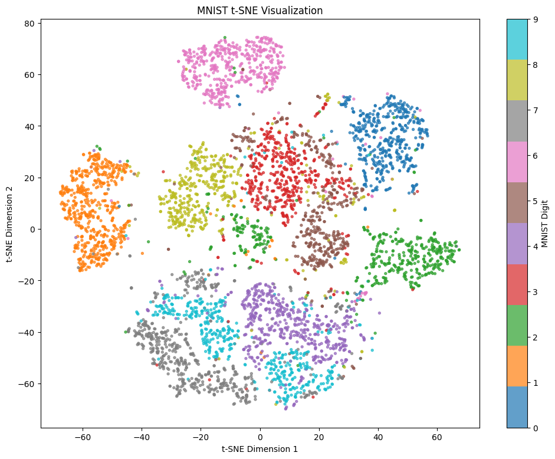
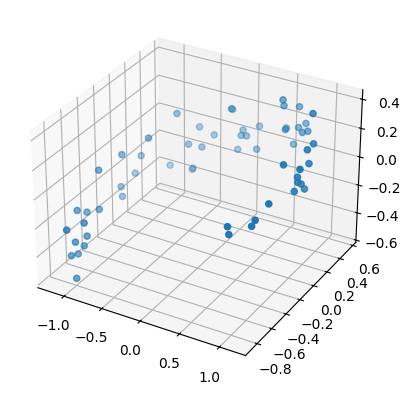
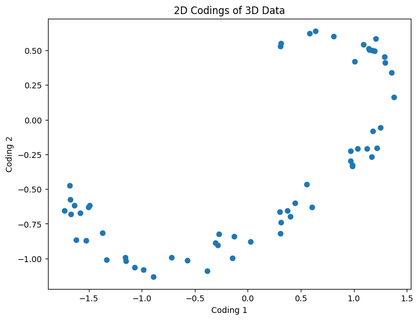
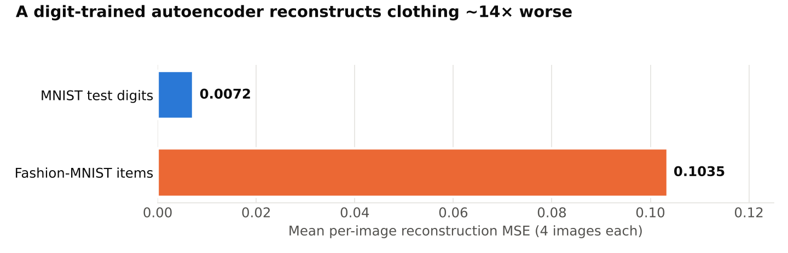
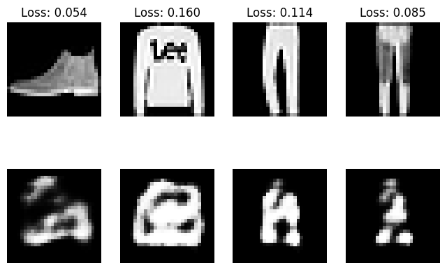
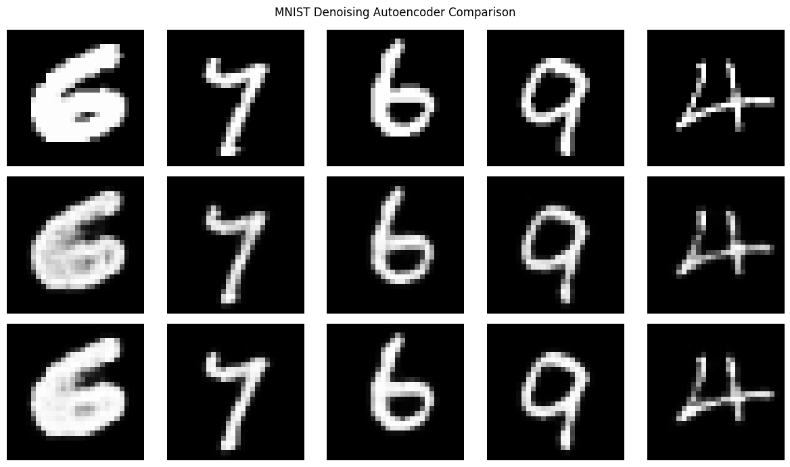
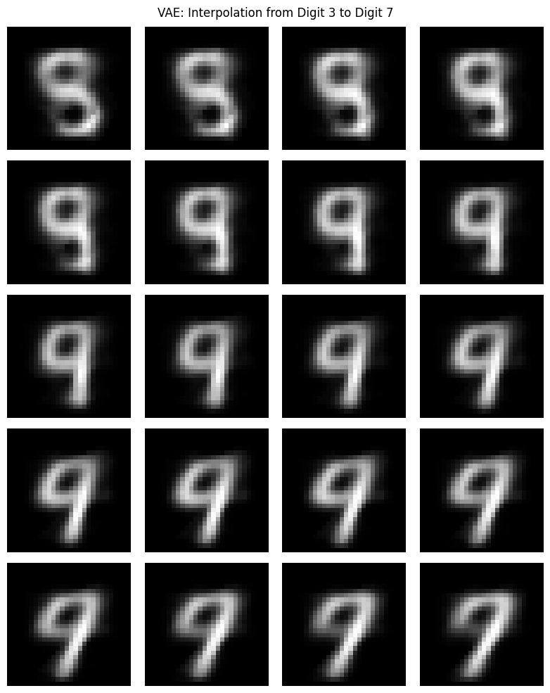

# Autoencoders and VAEs on MNIST: Compression, Anomaly Detection, Denoising, and Generation

> Six PyTorch experiments that build from a linear autoencoder to a variational autoencoder. They show what a learned bottleneck captures, how reconstruction error flags out-of-distribution inputs, how the input-dropout rate affects an overcomplete convolutional autoencoder, and how a VAE's latent space can be interpolated.


<p align="center">
  
  <br><em>t-SNE of the 32-D codings learned by the stacked autoencoder (5,000 training digits). The encoder never saw a label, yet the digits form distinct clusters.</em>
</p>

## Experiments at a glance

| # | Model | Question | Result (from saved outputs) |
|---|---|---|---|
| 1 | Linear AE, 3 → **2** → 3 | Can a linear bottleneck recover a 2-D structure hidden in 3-D? | Train MSE **0.0034**, validation MSE **0.0046** on 20 unseen points |
| 2 | Stacked AE, 784 → 128 → **32** → 128 → 784 | How well does a 24.5× compression reconstruct digits? | Summed epoch loss 55.5 → **19.4** in 5 epochs (≈ 0.030 → 0.010 mean batch MSE) |
| 3 | Same AE, scored on **Fashion-MNIST** | Does reconstruction error flag inputs from another distribution? | **~14× higher error** on clothing (0.1035 vs. 0.0072, 4 images each) |
| 4 | t-SNE of the 32-D codings | Does the unsupervised code organize by digit? | Clear per-digit clusters; 4 / 7 / 9 sit next to each other |
| 5 | Conv AE with input **dropout** 0.10 vs. 0.20 | How much corruption should regularize an overcomplete AE? | p = 0.10 gives lower error: training MSE 0.0034 vs. 0.0042 (5-image sample: 0.0034 vs. 0.0069) |
| 6 | **VAE**, 2-D latent | Can we generate digits by walking the latent space? | A gradual decoded path toward the 7; the 2-D latent decodes the 3 as 8-like and passes through 9-like shapes |

All six are in one notebook with outputs saved: [`notebooks/mnist_autoencoders_vae.ipynb`](notebooks/mnist_autoencoders_vae.ipynb).

## 1. Linear autoencoder: 3-D → 2-D

Sixty noisy points are generated near a tilted 2-D surface in 3-D. A two-layer **linear** autoencoder (no activations) is trained full-batch with NAdam for 300 steps. A linear autoencoder trained with MSE learns the same subspace as PCA, so its 2-D codings recover the hidden 2-D layout.

| 3-D input | 2-D codings |
|---|---|
|  |  |

## 2–3. Stacked autoencoder and out-of-distribution detection

A fully connected autoencoder compresses each 28×28 digit to **32 numbers** (ReLU encoder, sigmoid decoder output), trained for 5 epochs on all 60,000 MNIST training images.

I then fed it four **Fashion-MNIST** images it was never trained on. The decoder can only produce shapes from the digit space it learned, so clothing comes back as distorted digit-like blobs and the reconstruction error rises sharply. The same principle underlies reconstruction-based anomaly detection: inputs far from the training distribution reconstruct badly.

<picture>
  <source media="(prefers-color-scheme: dark)" srcset="images/ood_reconstruction_error_dark.png">
  
</picture>

<p align="center"><br><em>Top: Fashion-MNIST inputs. Bottom: reconstructions by the digit-trained autoencoder.</em></p>

## 4. Does the code organize by digit?

t-SNE projects the 32-D codings of 5,000 training images to 2-D (hero figure above). Without any labels, the codes separate into per-digit clusters. The visually similar **4 / 7 / 9** share a neighborhood, and **3 / 5 / 8** sit together in the center, mirroring the digit pairs that classifiers usually confuse.

## 5. Convolutional autoencoder with input dropout

```text
x ─Dropout(p)─Conv(1→16)─ReLU─MaxPool─Conv(16→32)─ReLU─MaxPool─►  code [32×7×7]
code ─ConvT(32→16, stride 2)─ReLU─ConvT(16→1, stride 2)─Sigmoid─►  x̂ [1×28×28]
```

The 32 × 7 × 7 code has **1,568** values, which is *more* than the 784-pixel input. Nothing in the architecture prevents the network from simply copying its input. Randomly zeroing input pixels during training (dropout-as-corruption, the denoising-autoencoder idea) is meant to push it toward modeling digit structure instead. This run compares the two corruption rates but does not measure held-out error. Both models are trained for 10 epochs with the same seed.

| Input dropout | Final training MSE | MSE on 5 sample digits (dropout off) |
|---:|---:|---:|
| **0.10** | **0.00342** | **0.00339** |
| 0.20 | 0.00419 | 0.00692 |

<p align="center"><br><em>Rows: original · dropout 0.20 · dropout 0.10.</em></p>

Heavier corruption gives blurrier reconstructions (see the thick "6" in the first column). The comparison is on clean training images, so it measures reconstruction quality under each regularization strength, not denoising performance (see *Next steps*).

## 6. Variational autoencoder and latent interpolation

The VAE encoder outputs a mean and log-variance for a **2-D** Gaussian latent. Samples are drawn with the **reparameterization trick** (`z = μ + ε·σ`). The loss is reconstruction MSE plus the KL divergence to N(0, I), scaled per pixel (`KL / 784`). Over 20 epochs the loss fell from 0.0645 to 0.0486.

To generate new images, I encoded a random **3** and a random **7**, linearly interpolated between their latent means in 20 steps, and decoded each point:

<p align="center"></p>

Consecutive frames change gradually. The KL term is designed to produce this kind of continuous latent space, though this run does not include a plain-autoencoder interpolation to compare against. The limits are just as visible: with only **2 latent dimensions**, the 3 already decodes closer to an 8, the straight line to the 7 passes through the region the VAE assigned to **9**, and every frame is blurry. Trying a larger latent (8–16 dimensions) and a BCE reconstruction loss are the natural next experiments.

## Repository structure

```text
mnist-denoising-autoencoder/
├── README.md
├── requirements.txt
├── notebooks/
│   └── mnist_autoencoders_vae.ipynb   # experiments 1–6, outputs saved
└── images/                            # figures exported from the notebook outputs
```

## How to run

```bash
git clone https://github.com/reidsendroff/mnist-denoising-autoencoder.git
cd mnist-denoising-autoencoder
python -m venv .venv && source .venv/bin/activate
pip install -r requirements.txt
jupyter lab notebooks/mnist_autoencoders_vae.ipynb
```

MNIST and Fashion-MNIST download automatically through torchvision into `./data`. Every experiment runs on a CPU; a GPU is used automatically for sections 5–6 if one is available.

## Next steps

- **True denoising benchmark:** corrupt the held-out *test* set (Gaussian and masking noise) and report PSNR/SSIM against clean targets for each dropout rate.
- **Quantified anomaly detection:** score all 10,000 MNIST and Fashion-MNIST test images and report ROC-AUC for reconstruction error as an OOD detector (the current comparison uses 4 images per set).
- **VAE:** compare latent sizes (2 / 8 / 16), BCE vs. MSE reconstruction, and a β-VAE sweep; visualize the 2-D latent grid.

## Skills demonstrated

**Representation learning:** undercomplete, stacked, convolutional, denoising-style, and variational autoencoders; reparameterization trick; KL regularization; latent-space interpolation; t-SNE.
**Applied ML:** reconstruction-based anomaly and out-of-distribution detection, regularization trade-offs, reading reconstructions qualitatively *and* quantitatively.
**Tooling:** PyTorch (`nn.Module`, `ConvTranspose2d`, custom losses), torchvision datasets, scikit-learn, matplotlib.

## Context

Built by **Reid Sendroff** for Harvard Extension School's graduate **CSCI E-89 Deep Learning** course (2026).
